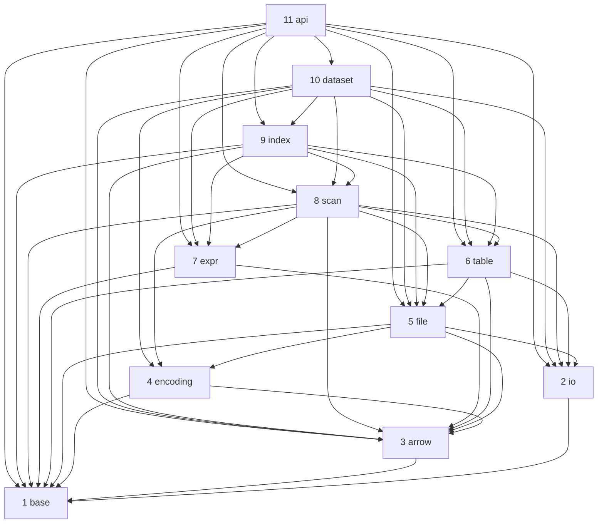

<!-- Generated by tools/gen_layer_docs.py. Do not edit by hand. -->
# Layers

*Generated by `tools/gen_layer_docs.py` from `tools/layout.py` and the includes in `src/`. Do not edit by hand.*

A layer may use any layer below it. The table lists the layers top first, and the diagram shows the layers each one actually uses.

| Number | Layer | What it is | Uses | Used by |
|---|---|---|---|---|
| 11 | [api](../src/api/README.md) | the C APIs and lance-c | base, io, arrow, file, table, expr, scan, index, dataset | none |
| 10 | [dataset](../src/dataset/README.md) | user operations: write sessions, updates, merge_insert, compaction, index lifecycle, query planning | io, arrow, encoding, file, table, expr, scan, index | api |
| 9 | [index](../src/index/README.md) | each index kind: build, look up, describe | base, arrow, file, table, expr, scan | dataset, api |
| 8 | [scan](../src/scan/README.md) | reading rows of fragments, given a row selection | base, io, arrow, encoding, file, table, expr | index, dataset, api |
| 7 | [expr](../src/expr/README.md) | what a filter means (no storage) | base, arrow | scan, index, dataset, api |
| 6 | [table](../src/table/README.md) | what a version is: manifest, fragments, deletions, row ids, transactions, refs, index metadata | base, io, arrow, file | scan, index, dataset, api |
| 5 | [file](../src/file/README.md) | how a .lance file is framed: footer, column metadata, global buffers, blobs | base, io, arrow, encoding | table, scan, index, dataset, api |
| 4 | [encoding](../src/encoding/README.md) | how one page of one column is laid out (both directions) | base, arrow | file, scan, dataset |
| 3 | [arrow](../src/arrow/README.md) | Arrow arrays and schemas, and how they map to Lance's types | base | encoding, file, table, expr, scan, index, dataset, api |
| 2 | [io](../src/io/README.md) | where bytes live: local files and object stores (S3 is a registered backend) | base | file, table, scan, dataset, api |
| 1 | [base](../src/base/README.md) | threads, statistics, safety limits, small numerics and helpers | none | io, arrow, encoding, file, table, expr, scan, index, api |

